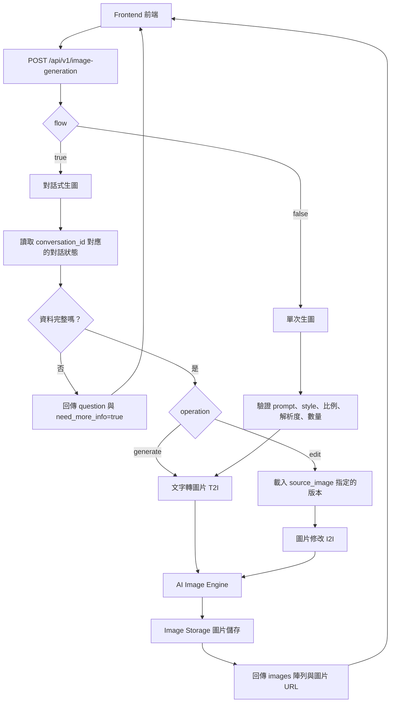

# AI 生圖系統 API 介面契約

- **文件名稱：** AI Image Generation API Interface Contract
- **版本：** 1.0.0
- **狀態：** Draft（供團隊確認與實作）
- **資料格式：** JSON（UTF-8）
- **主要入口：** `POST /api/v1/image-generation`

## 1. 目的與範圍

本文件定義前端（Frontend）與生圖後端（Backend）之間的資料交換格式。系統提供兩種生圖模式：

1. **對話式生圖（`flow: true`）**：使用者透過多輪對話描述需求；系統可以追問必要資訊，也可以依照既有圖片繼續修改。
2. **單次生圖（`flow: false`）**：使用者一次提交完整生成參數，後端直接呼叫生圖引擎。

本契約規範 JSON 欄位、資料型別、流程、回應格式與錯誤格式。前端負責收集資料及顯示問題／圖片；後端負責驗證、流程分派、對話狀態管理及呼叫 AI 生圖引擎。

## 2. 系統資料流



## 3. API 基本規格

| 項目 | 規格 |
|---|---|
| HTTP Method | `POST` |
| Endpoint | `/api/v1/image-generation` |
| Request Content-Type | `application/json` |
| Response Content-Type | `application/json` |
| 字元編碼 | UTF-8 |

### 3.1 `flow` 模式選擇

| JSON 值 | 模式 | 說明 |
|---|---|---|
| `true` | 對話式生圖 | 允許多輪對話、追問及圖片修改 |
| `false` | 單次生圖 | 一次提交完整生圖參數 |

JSON Boolean 必須使用 `true` 或 `false`，不可使用字串 `"true"`／`"false"`，也不可用數字 `1`／`0` 代替。

## 4. Request 規格

### 4.1 對話式生圖：首次生成

當使用者第一次提出生圖需求時，`operation` 使用 `generate`。

**Request 範例**

```json
{
  "flow": true,
  "conversation_id": "conv_001",
  "operation": "generate",
  "message": "請生成一張未來科技城市，夜晚、紫色霓虹燈的風格。"
}
```

**欄位定義**

| 欄位 | 型別 | 必填 | 說明 |
|---|---|---:|---|
| `flow` | Boolean | 是 | 固定為 `true` |
| `conversation_id` | String | 是 | 對話識別碼；第一次可由前端建立 UUID，或由後端提供建立方式 |
| `operation` | String | 是 | 本次操作；首次生圖使用 `generate` |
| `message` | String | 是 | 使用者的自然語言需求或補充回答 |

### 4.2 對話式生圖：資料不足，後端追問

若後端判斷目前資訊不足以可靠地執行生成，回傳問題。前端顯示 `question`，使用者回答後，再以相同 `conversation_id` 傳送新的 `message`。

**Response 範例**

```json
{
  "request_id": "req_001",
  "status": "needs_clarification",
  "conversation_id": "conv_001",
  "need_more_info": true,
  "question": "你希望圖片中出現飛行汽車嗎？"
}
```

**後續 Request 範例**

```json
{
  "flow": true,
  "conversation_id": "conv_001",
  "operation": "generate",
  "message": "要，請在城市上空加入幾台飛行汽車。"
}
```

對話紀錄由後端依 `conversation_id` 管理。前端不需要每次重新傳送完整對話歷史，除非雙方日後另行約定。

### 4.3 對話式生圖：完成首次生成

**Response 範例**

```json
{
  "request_id": "req_002",
  "status": "completed",
  "conversation_id": "conv_001",
  "need_more_info": false,
  "images": [
    {
      "image_id": "img_001",
      "version": 1,
      "parent_image_id": null,
      "url": "/api/v1/images/img_001",
      "width": 1024,
      "height": 1024
    }
  ]
}
```

### 4.4 對話式生圖：修改已生成圖片

使用者要求修改圖片時，`operation` 使用 `edit`，並指定要修改的圖片版本。後端應以該版本作為來源，不可只依賴「上一張圖片」等模糊描述。

**Request 範例**

```json
{
  "flow": true,
  "conversation_id": "conv_001",
  "operation": "edit",
  "message": "把天空改成紫色，其他構圖保持不變。",
  "source_image": {
    "image_id": "img_001",
    "version": 1
  }
}
```

**Response 範例**

```json
{
  "request_id": "req_003",
  "status": "completed",
  "conversation_id": "conv_001",
  "need_more_info": false,
  "images": [
    {
      "image_id": "img_002",
      "version": 2,
      "parent_image_id": "img_001",
      "url": "/api/v1/images/img_002",
      "width": 1024,
      "height": 1024
    }
  ]
}
```

每次修改都建立新的圖片紀錄，保留舊版本。`parent_image_id` 指向本次修改所依據的來源圖片。若同一張圖有不同修改分支，版本號應由後端在各自的圖片序列中管理，不應由前端自行推算。

### 4.5 單次生圖

單次生圖一次提交完整參數。若必填欄位缺失或格式錯誤，後端回傳 `400 Bad Request` 與標準錯誤物件，不進入對話追問流程。

**Request 範例**

```json
{
  "flow": false,
  "prompt": "一座未來科技城市，夜晚，紫色霓虹燈",
  "style": "Cyberpunk",
  "aspect_ratio": {
    "width": 16,
    "height": 9
  },
  "resolution": {
    "width": 1024,
    "height": 576
  },
  "count": 2
}
```

**欄位定義**

| 欄位 | 型別 | 必填 | 說明 |
|---|---|---:|---|
| `flow` | Boolean | 是 | 固定為 `false` |
| `prompt` | String | 是 | 生圖提示詞 |
| `style` | String | 是 | 藝術風格，可先採自由文字；若未來改成固定選項，需另訂允許值 |
| `aspect_ratio.width` | Integer | 是 | 比例的寬向數值，例如 16 |
| `aspect_ratio.height` | Integer | 是 | 比例的高向數值，例如 9 |
| `resolution.width` | Integer | 是 | 輸出圖片寬度，單位 pixel |
| `resolution.height` | Integer | 是 | 輸出圖片高度，單位 pixel |
| `count` | Integer | 是 | 要求生成的圖片張數，至少 1 張 |

**Response 範例**

```json
{
  "request_id": "req_004",
  "status": "completed",
  "images": [
    {
      "image_id": "img_101",
      "version": 1,
      "parent_image_id": null,
      "url": "/api/v1/images/img_101",
      "width": 1024,
      "height": 576
    },
    {
      "image_id": "img_102",
      "version": 1,
      "parent_image_id": null,
      "url": "/api/v1/images/img_102",
      "width": 1024,
      "height": 576
    }
  ]
}
```

### 4.6 參考圖片的傳送方式

圖片檔案不建議直接以一般 JSON 字串傳送。建議先透過圖片上傳介面上傳，取得 `asset_id`，再於生圖 Request 內引用該識別碼。以下為可選欄位範例：

```json
{
  "input_image": {
    "asset_id": "asset_001"
  }
}
```

`input_image` 可作為單次生圖或對話式首次生成的參考圖片。對話式修改已生成圖片時，使用 `source_image` 指定既有生成版本。圖片上傳 Endpoint 與檔案大小、格式限制需由團隊另行訂定。

## 5. Response 共通規格

| 欄位 | 型別 | 說明 |
|---|---|---|
| `request_id` | String | 每次 API 請求的唯一識別碼，供除錯與追蹤 |
| `status` | String | `needs_clarification`、`completed` 或 `failed` |
| `conversation_id` | String | 對話式生圖的對話識別碼；單次生圖可省略 |
| `need_more_info` | Boolean | 對話式生圖是否需要使用者補充資料 |
| `question` | String | `need_more_info` 為 `true` 時，後端提出的問題 |
| `images` | Array | 成功生成的圖片資料；每筆包含圖片識別碼、版本、URL 與尺寸 |
| `error` | Object | 失敗時的錯誤資訊 |

### 5.1 圖片顯示

後端回傳 `images[].url` 後，前端使用該 URL 載入圖片並顯示。JSON Response 傳遞的是圖片位置與中繼資料，不是圖片本身的二進位內容。

## 6. 錯誤處理

**錯誤 Response 範例**

```json
{
  "request_id": "req_005",
  "status": "failed",
  "error": {
    "code": "INVALID_RESOLUTION",
    "message": "resolution.width 與 resolution.height 必須是正整數。",
    "retryable": false
  }
}
```

| HTTP Status | 情況 | 前端處理方式 |
|---|---|---|
| `200 OK` | 已成功處理；可能是追問或完成生成 | 依 `status` 顯示問題或圖片 |
| `400 Bad Request` | JSON 格式錯誤、缺少必填欄位或欄位值不合法 | 顯示錯誤訊息，修正資料後重送 |
| `404 Not Found` | 找不到指定的對話或圖片版本 | 提示使用者重新選擇或建立對話 |
| `413 Payload Too Large` | 上傳圖片超過大小限制 | 提示使用者更換較小圖片 |
| `415 Unsupported Media Type` | Content-Type 或圖片格式不支援 | 提示使用支援的格式 |
| `500 Internal Server Error` | 後端或生圖引擎發生未預期錯誤 | 顯示一般錯誤訊息，記錄 request_id |
| `503 Service Unavailable` | 生圖引擎暫時無法服務 | 可稍後重試 |

## 7. 模組責任分工

| 模組 | 責任 |
|---|---|
| Frontend | 收集提示詞與參數、傳送 JSON、顯示追問、顯示圖片與版本 |
| Backend API | 驗證 JSON、辨識 `flow`、管理請求與回應格式 |
| Conversation Manager | 依 `conversation_id` 保存對話上下文、管理追問狀態 |
| LLM | 理解使用者需求、整理生圖指令、判斷是否需要追問 |
| Image Engine | 執行文字轉圖片（Text-to-Image, T2I）及圖片修改（Image-to-Image, I2I） |
| Image Storage | 儲存圖片、版本及其關聯，提供圖片 URL |

## 8. 實作時必須遵守的規則

1. `flow` 只負責選擇對話式或單次生圖，不應同時承擔生成／修改的判斷；對話式生圖另用 `operation` 區分 `generate` 與 `edit`。
2. `need_more_info` 是後端 Response 的 Boolean。`true` 表示前端顯示 `question` 並等待使用者回答；`false` 表示不需要追問。
3. 對話式生圖的每一輪都使用相同的 `conversation_id`，由後端保存上下文。
4. 修改圖片必須指定 `source_image.image_id` 與 `source_image.version`。
5. 修改結果建立新圖片紀錄，不覆蓋來源圖片；使用 `parent_image_id` 保留版本關係。
6. `aspect_ratio` 表示比例，`resolution` 表示實際像素尺寸，兩者不可混用。若本契約要求比例一致，`16:9` 的解析度可使用 `1024×576`，不可填成 `1024×1024`。
7. `count` 必須是大於或等於 1 的整數。實際最大張數應依部署的生圖引擎與服務限制另行設定。
8. `images` 是陣列，即使只生成一張也維持陣列格式，讓前端只需實作一種解析方式。
9. 前端不得自行假設圖片已生成完成；應以 Response 的 `status` 為準。
10. 本版本以同步 Request／Response 為基本範例。若生圖時間過長，後續可擴充 `202 Accepted`、`job_id` 與工作狀態查詢介面。

## 9. 待團隊確認的項目

以下項目不應由前後端各自猜測，正式開發前需共同決定：

- 生圖引擎允許的解析度清單及最大像素量。
- 單次最多生成幾張圖片（`count` 上限）。
- 支援的圖片輸入格式、上傳大小及保存期限。
- 對話與圖片的保存期限，以及使用者刪除對話時的圖片處理方式。
- 生圖採同步等待，或改成非同步工作佇列。
- `style` 是否使用自由文字，或改成後端維護的固定風格代碼。

---

**文件維護原則：** 任何欄位名稱、型別、必填條件或狀態值的變更，都應同步更新本文件與 JSON Schema，並通知前端、後端及 AI 引擎負責人。
